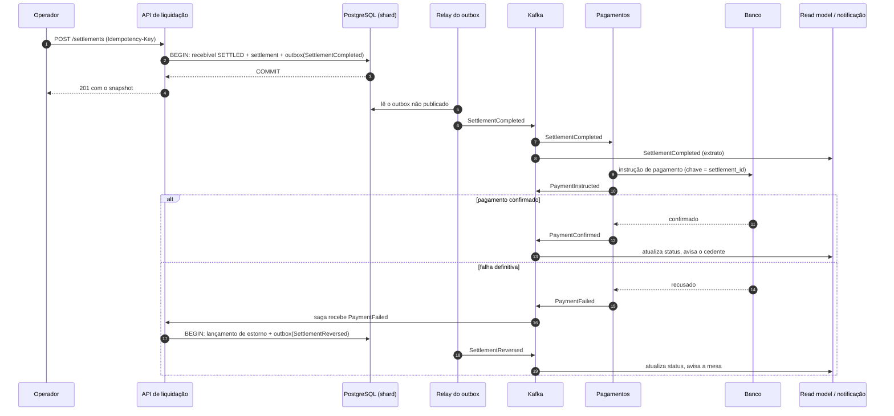

# Arquitetura orientada a eventos para a liquidação

> **Proposta de desenho, não implementada.** Hoje a liquidação é síncrona e termina no registro ([ADR 0003](adr/0003-liquidacao-sincrona-outbox-como-evolucao.md)). Este documento descreve a evolução para quando houver integração com um sistema de pagamentos real e volume que justifique ([`SCALE.md`](SCALE.md)).

## Por que eventos aqui

Depois de liquidar, um sistema real precisa instruir o pagamento, esperar a confirmação do banco e avisar o cedente. Esses passos são lentos, dependem de terceiros e podem falhar depois de a liquidação estar gravada. Fazê-los dentro da transação seguraria locks durante chamadas de rede. Fazê-los com duas escritas soltas (banco e broker) repetiria o defeito do Anexo A: duas operações sem atomicidade.

## Duas fases

- **Fase 1, na integração com pagamentos.** A decisão de liquidar continua síncrona e na transação local, como hoje. O operador continua recebendo `201` ou um erro na hora. A diferença é que a transação também grava `SettlementCompleted` no outbox, e o resto do fluxo segue por eventos.
- **Fase 2, só se o volume exigir.** A entrada também fica assíncrona: a API valida, grava `SettlementRequested` e responde `202 Accepted`, e um processador por partição decide a liquidação. É mais complexo para o operador (seção "O que muda para o operador") e só se justifica se a fase 1 não aguentar a escala.

## Eventos

Todos os eventos têm `event_id` (UUID), `event_type`, `schema_version`, `occurred_at`, `receivable_id` e `correlation_id`, que é o mesmo `X-Correlation-Id` que a API já propaga ([`CorrelationIdFilter`](../backend/src/main/java/com/srmasset/creditengine/web/CorrelationIdFilter.java)). Valores monetários vão como string decimal, como na API.

A chave de partição no Kafka é sempre `receivable_id`, então os eventos de um recebível chegam em ordem.

| Evento | Quem produz | Quem consome | Conteúdo principal |
|---|---|---|---|
| `SettlementRequested` *(só na fase 2)* | API | Processador de liquidação | `idempotency_key`, `receivable_id`, `payment_currency` |
| `SettlementCompleted` | Liquidação, via outbox | Pagamentos, read model do extrato, notificação | Snapshot completo: `settlement_id`, valores, taxa base, spread, prazo, `fx_rate_id`, `fx_rate`, `net_amount`, `settled_at` |
| `PaymentInstructed` | Pagamentos | Saga, read model | `payment_id`, `settlement_id`, valor, moeda, conta do cedente (referência, não o dado) |
| `PaymentConfirmed` | Pagamentos, ao receber o retorno do banco | Saga, read model, notificação | `payment_id`, `settlement_id`, `confirmed_at` |
| `PaymentFailed` | Pagamentos | Saga | `payment_id`, `settlement_id`, motivo, se é definitivo |
| `SettlementReversed` | Liquidação, via outbox | Read model, notificação, contabilidade | `reversal_id`, `settlement_id`, valores estornados, motivo |

`PaymentFailed` não estava na lista inicial da spec. Ele entra porque a compensação precisa de um gatilho explícito: sem ele, a saga só saberia que o pagamento falhou por timeout.

## Fluxo



## Outbox

Uma tabela por shard, gravada na mesma transação da mudança de estado:

```sql
create table outbox (
    event_id      uuid primary key default uuidv7(),
    aggregate_id  uuid not null,          -- receivable_id, também a chave da partição
    event_type    text not null,
    payload       jsonb not null,
    occurred_at   timestamptz not null,
    published_at  timestamptz            -- null até o relay publicar
);
create index outbox_unpublished_idx on outbox (occurred_at) where published_at is null;
```

O relay publica e depois marca `published_at`. Se cair entre os dois passos, publica de novo: entrega at-least-once, por design. Linhas publicadas podem ser expurgadas depois de um prazo. A auditoria continua na tabela `settlements`, que é imutável, não no outbox.

## Saga: orquestrada, com compensação por estorno

- **Orquestrada, não coreografada.** O serviço de liquidação é dono do ciclo de vida do dinheiro e mantém o estado da saga por liquidação: `COMPLETED` → `PAYMENT_INSTRUCTED` → `PAID` ou `REVERSED`.
- **Por que orquestrar.** Numa coreografia, cada serviço reage aos eventos dos outros e ninguém sabe dizer em que estado está um pagamento. Para dinheiro, a pergunta "onde está esta liquidação?" precisa ter um dono e uma resposta.
- **Compensação é estorno, nunca alteração.** A liquidação gravada é imutável (premissa A12, trigger em [`V1__initial_schema.sql`](../backend/src/main/resources/db/migration/V1__initial_schema.sql)). Compensar significa gravar um novo lançamento de estorno que referencia a liquidação original, com seus próprios valores e timestamp. O histórico mostra os dois lançamentos, como na contabilidade.
- **Quando compensar.** Só em `PaymentFailed` definitivo, como conta inexistente ou recusa do banco. Falha transitória ou timeout não dispara estorno: primeiro consulta o status do pagamento no banco. Estornar um pagamento que na verdade saiu é o mesmo erro do Anexo B ao contrário.
- **Estorno exige decisão humana na primeira versão.** O estorno de liquidação está fora do escopo atual ([`SPEC.md`](../SPEC.md), A12). Quando entrar, começa com aprovação da mesa, e não como compensação 100% automática, até haver confiança nos sinais de falha definitiva.

## Garantias e falhas

| Situação | O que acontece |
|---|---|
| Relay cai | O outbox acumula; nada se perde. Alerta pela idade da linha mais antiga não publicada. |
| Evento publicado duas vezes | Os consumidores são idempotentes pelo `event_id`: o registro do evento processado e o efeito ficam na mesma transação do consumidor. |
| Pagamentos recebe `SettlementCompleted` duas vezes | A instrução ao banco usa `settlement_id` como chave de idempotência. O banco não paga duas vezes, a mesma ideia da [ADR 0005](adr/0005-idempotencia-em-tres-barreiras.md) aplicada um passo adiante. |
| Eventos fora de ordem | Não acontece dentro de um recebível, porque a partição é por `receivable_id`. Entre recebíveis, a ordem não importa. |
| Mensagem que sempre falha | Vai para uma dead-letter queue depois de N tentativas, com alerta. Não bloqueia a partição. |
| Mudança de formato do evento | O campo `schema_version` e mudanças só aditivas. Uma mudança incompatível vira um novo tipo de evento. |

## O que muda para o operador

- **A confirmação muda de significado.** O `201` passa a querer dizer "liquidação registrada, pagamento em andamento", não "pago". A tela mostra o status do pagamento: *Liquidada* → *Pagamento instruído* → *Pago* ou *Estornado*.
- **O extrato fica eventualmente consistente.** Uma liquidação recém-feita pode levar alguns segundos para aparecer, e a tela mostra até quando os dados estão atualizados ([`SCALE.md`](SCALE.md), seção 6).
- **Falha de pagamento vira tarefa da mesa,** com o motivo e o estorno proposto, em vez de um erro na hora do clique, que acontece antes de o banco responder.
- **Na fase 2, o clique não tem resposta imediata.** A tela acompanha o pedido até a decisão, e erros de negócio como câmbio vencido chegam depois. É a principal razão para ficar na fase 1 enquanto o volume permitir.
