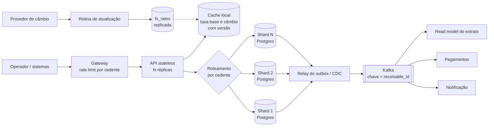

# Desenho de alta escala: 1 milhão de transações por minuto

> **Documento de desenho, não de medição.** Nada aqui foi testado com carga nesta escala. A única medição de desempenho do repositório é a do extrato com 100 mil liquidações, no [README](../README.md#desempenho-do-extrato). Os números abaixo são aritmética sobre a meta ou hipóteses, e estão marcados como tal.

## A meta em números

- 1.000.000 por minuto ÷ 60 = **cerca de 16.700 por segundo, em média**. O pico real é maior que a média e precisa ser medido antes de dimensionar.
- **Premissa:** "transação" é uma liquidação, o pior caso, porque escreve. Simulações são leituras puras de CPU e escalam muito mais fácil. Se a mistura real for, por exemplo, 90% simulação, a pressão de escrita cai na mesma proporção.

## Onde o desenho atual quebra

Hoje ([ADR 0001](adr/0001-postgresql-relacional.md), [ADR 0002](adr/0002-monolito-modular.md)), cada liquidação faz, numa transação de um único primário PostgreSQL:
- uma leitura da chave de idempotência;
- as leituras do recebível, da taxa base e do câmbio;
- o UPDATE do recebível com `@Version`;
- o INSERT em `settlements`, com duas constraints únicas e dois índices do extrato.

Isso é correto, mas tem três gargalos nesta escala:

1. **Um primário para todas as escritas.** Escala só verticalmente. Apostar que um primário sustenta 16.700 transações de escrita por segundo, com folga, é uma aposta que este desenho não faz.
2. **Leituras repetidas de dado quase estático.** A taxa base e o câmbio são lidos do banco a cada liquidação, e mudam poucas vezes por dia.
3. **O extrato no mesmo banco das escritas.** Consultas analíticas disputam recursos com a liquidação. É exatamente o gatilho hipotético do incidente em [`POSTMORTEM.md`](../POSTMORTEM.md).

## Arquitetura proposta

### 1. Motor stateless, escalado horizontalmente

O [`PricingEngine`](../backend/src/main/java/com/srmasset/creditengine/domain/pricing/PricingEngine.java) é uma função pura: entrada, taxa base e câmbio produzem o resultado. A API não guarda estado entre requisições, então escala adicionando réplicas atrás do balanceador. A simulação, que deve ser a maior parte do tráfego, nem toca o banco de escrita.

### 2. Taxa base e câmbio em cache local, com versão

- Cada réplica mantém em memória a tabela de taxas vigentes, recarregada quando aparece uma versão nova (novo `valid_from` ou novo ID). A recarga é disparada por um evento de "taxa publicada" ou por uma consulta curta e periódica.
- **A semântica não muda.** A taxa usada continua sendo a de maior vigência menor ou igual ao instante ([ADR 0006](adr/0006-cambio-lido-do-banco.md)). A liquidação continua gravando `fx_rate_id` e `fx_rate`, então a auditoria vale como hoje.
- **A regra de taxa velha continua no caminho.** Se o cache tem uma taxa com mais de 24h, a liquidação em USD é recusada. Um cache desatualizado nunca vira fallback silencioso.
- **Risco aceito:** durante a propagação de uma taxa nova, réplicas diferentes podem usar versões diferentes por alguns segundos. Cada liquidação registra qual usou, então o resultado continua reproduzível.

### 3. Banco particionado por cedente, com tratamento do cedente "quente"

- **Chave de particionamento: `cedente_id`.** Uma liquidação toca um recebível, que pertence a um cedente. Com essa chave, toda a transação acontece dentro de um shard só, e a atomicidade continua sendo uma transação local, sem transação distribuída.
- **O problema do cedente quente.** Um cedente grande pode concentrar boa parte do volume e saturar o seu shard, enquanto os outros ficam ociosos. Particionar só por cedente não distribui carga quando a carga não é distribuída.
- **Tratamento:** cedentes acima de um limiar ganham sub-partições virtuais por `hash(receivable_id) % k`. Uma tabela de roteamento, pequena e em cache, mapeia `(cedente_id, sub-partição)` para um shard.
  - O roteamento de um recebível é determinístico e não muda: o recebível nasce num shard e fica lá.
  - Por isso, `UNIQUE (receivable_id)` continua valendo dentro do shard que o contém.
- **Custo:** consultas por cedente inteiro deixam de ser locais. É por isso que o extrato sai do banco transacional (seção 6).

Alternativa descartada: particionar direto por `hash(receivable_id)`. Distribui melhor desde o primeiro dia, mas espalha cada cedente por todos os shards e torna caro qualquer controle por cedente, como limites de exposição. Começar por cedente e dividir só os quentes mantém a localidade onde ela importa.

### 4. Outbox com Kafka

A transação da liquidação grava, no mesmo shard e no mesmo commit, uma linha na tabela `outbox` ([ADR 0003](adr/0003-liquidacao-sincrona-outbox-como-evolucao.md)). Um relay (CDC sobre o WAL, por exemplo com Debezium, ou polling com `FOR UPDATE SKIP LOCKED`) publica no Kafka. Os eventos e a saga estão em [`EDA.md`](EDA.md).

- **Chave da mensagem: `receivable_id`.** Todos os eventos de um recebível caem na mesma partição do tópico, e a ordem por recebível é preservada.
- **Entrega at-least-once:** o relay pode publicar o mesmo evento mais de uma vez (cai depois de publicar e antes de marcar). Quem garante o efeito único é o consumidor (seção 5).

### 5. O que muda na semântica de idempotência

Hoje a idempotência é global e eterna: `UNIQUE (idempotency_key)` numa tabela única, sem expiração ([ADR 0005](adr/0005-idempotencia-em-tres-barreiras.md)). Nesta escala, ela passa a ser **por partição** e **com prazo**.

| Aspecto | Hoje | Em escala |
|---|---|---|
| Onde a chave é verificada | Tabela única, unicidade global | Tabela de deduplicação no shard do recebível |
| Roteamento | Não há | A chave viaja com o `receivable_id` e é verificada no shard dele |
| Retenção | Para sempre, na própria liquidação | Tabela de deduplicação com TTL. O TTL precisa ser maior que a janela máxima de retry de clientes e gateways |
| Retry depois do TTL | Não acontece | A chave já expirou, mas `UNIQUE (receivable_id)` no shard ainda barra: o cliente recebe `409` em vez da confirmação original. Dinheiro protegido, experiência pior, e por isso o TTL é generoso |
| Consumidores do Kafka | Não existem | Idempotentes pelo `event_id`: o registro do evento processado e o efeito são gravados na mesma transação do consumidor |

O resultado é entrega **at-least-once** com efeito **exactly-once**: a mensagem pode chegar duas vezes, mas o efeito acontece uma vez só. Exactly-once de ponta a ponta no transporte não existe; o que existe é deduplicação no ponto em que o efeito acontece.

As três barreiras continuam, cada uma no seu shard: a chave de idempotência, o status com `@Version` e a unicidade de `receivable_id`. Nenhuma depende de coordenação entre shards.

### 6. Extrato como read model, com consistência eventual

- O extrato deixa de consultar os shards. Um consumidor de `SettlementCompleted` alimenta um banco de leitura próprio, particionado por data e indexado por cedente e moeda: um PostgreSQL de leitura particionado por mês, ou um banco colunar se as consultas analíticas crescerem.
- **Consistência eventual.** Uma liquidação aparece no extrato com algum atraso, que é o lag do consumidor. A tela do extrato mostra "atualizado até HH:MM:SS", calculado pelo último evento processado. A confirmação da liquidação continua vindo da resposta síncrona, nunca do extrato.
- O SQL de hoje ([`SettlementStatementRepository`](../backend/src/main/java/com/srmasset/creditengine/persistence/SettlementStatementRepository.java)) se aplica quase igual ao read model.

### 7. Proteções na borda

- **Rate limit por cedente** no gateway, para um cliente não consumir o shard de todos.
- **Timeouts alinhados.** O timeout do gateway deve ser maior que o tempo máximo da requisição no servidor. Se for menor, o gateway desiste enquanto o servidor ainda grava, e esse é o mecanismo do incidente do Anexo B. Com a idempotência, o retry fica seguro, mas continua sendo carga desperdiçada.
- **Pool de conexões** na frente de cada shard (PgBouncer), porque N réplicas da API com pools próprios esgotariam as conexões do PostgreSQL.

## O que continua forte e o que pode ser eventual

| Continua com consistência forte | Pode ser eventual |
|---|---|
| A liquidação de um recebível: uma transação local num shard, com as três barreiras | O extrato e os relatórios (read model) |
| A seleção da taxa de câmbio pela vigência, registrada na liquidação | As métricas e os dashboards |
| A resposta ao operador: liquidado ou erro, nunca "talvez" | A notificação ao cedente |
| A unicidade de `receivable_id` | A instrução e a confirmação de pagamento (saga em [`EDA.md`](EDA.md)) |

A regra é: o que decide se o dinheiro sai fica forte; o que só informa pode atrasar.

## Observabilidade nesta escala

Além das métricas de hoje (`settlements_total` por `currency` e `result`, `pricing_engine_duration`), passam a ser essenciais:
- o lag dos consumidores por partição e o backlog do outbox (linhas não publicadas e idade da mais antiga);
- a taxa de `replayed` e de `conflict` por shard: um aumento indica retries em massa ou cedente quente;
- a distribuição de carga entre shards, para detectar o cedente quente antes que ele sature.

## Ordem de evolução

Não é um big bang. Cada passo só entra quando a medição mostra a necessidade.

1. **Teste de carga do desenho atual,** para descobrir o limite real de um primário. Hoje esse número não existe.
2. **Cache de taxa base e câmbio** e réplicas da API. É barato e não muda a semântica.
3. **Outbox e Kafka,** já necessários para integrar pagamentos ([ADR 0003](adr/0003-liquidacao-sincrona-outbox-como-evolucao.md)).
4. **Extrato em read model,** tirando a carga analítica do banco de escrita.
5. **Particionamento por cedente,** o passo mais caro e o último. Só quando um primário, com as leituras já fora dele, deixar de bastar.
